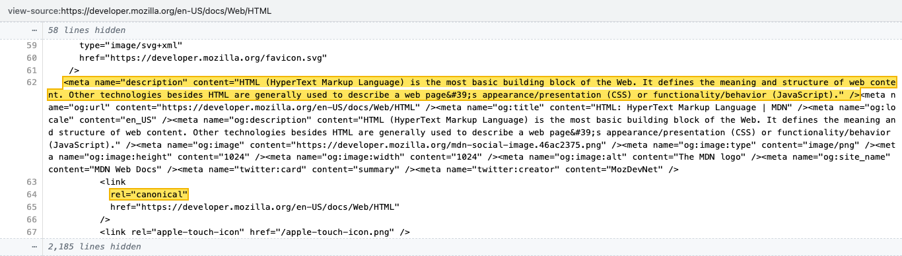

# playwright-vsource

An MCP server that fetches a page's raw HTML the way a real browser does, renders it like Chrome's `view-source:` (line numbers, monospace), highlights what you're looking for, and saves a screenshot.

It's built for proof screenshots: "the canonical is fixed", "hreflang now points here", "the meta description no longer double-encodes `&`". Playwright can't open `view-source:` URLs, so this rebuilds the view instead.



## Features

- Highlights only the matched text, not the whole line, so long minified lines stay readable.
- Plain-text matches also find their JSON-escaped form (`/` → `\/`), so URLs inside JSON-LD are found. Prefix a match with `re:` for a regex.
- By default only the matched lines and their context are shown, with long gaps collapsed into "⋯ N lines hidden".
- `hide_params` sends query parameters (preview tokens, auth keys) but leaves them out of the header.
- Saves to `~/Desktop` by default, and returns the matched line numbers so you can quote them.

## Install

Requires Node 18+.

```bash
git clone https://github.com/devnazir/playwright-vsource.git
cd playwright-vsource
npm install
npx playwright install chromium chromium-headless-shell
```

### Claude Code

```bash
claude mcp add playwright-vsource --scope user -- node /absolute/path/to/playwright-vsource/src/index.js
```

To also install the skill that tells Claude when and how to use the tools:

```bash
mkdir -p ~/.claude/skills
cp -r skills/view-source-proof ~/.claude/skills/
```

### Other MCP clients

```json
{
  "mcpServers": {
    "playwright-vsource": {
      "command": "node",
      "args": ["/absolute/path/to/playwright-vsource/src/index.js"]
    }
  }
}
```

## Tools

### `view_source_screenshot`

| Argument | Type | Description |
|---|---|---|
| `url` | string | Page to read the source of. Required. |
| `match` | string[] | Text to highlight. `re:` prefix for a regex. |
| `lines` | number[] | Line numbers to highlight in full. |
| `hide_params` | string[] | Query parameters to send but leave out of the header. |
| `mode` | `"matches"` \| `"first"` | `matches` (default): only matched lines plus context. `first`: one viewport of the full source, scrolled to the first match. |
| `context_lines` | number | Context lines around each match (default 4). |
| `out` | string | Output PNG path. Default `~/Desktop/vsource-<host-path>-<time>.png`. |
| `label` | string | Suffix for the default filename, e.g. `before` / `after`. |
| `width` | number | Viewport width in px (default 1366). |

Returns the saved path, the URL shown in the header, the HTTP status, and each highlighted line's number and text.

### `view_source_find`

Same `url`, `match`, `lines` and `hide_params` arguments. Returns the matching line numbers and text without taking a screenshot, so you can check a match before shooting.

## CLI

```bash
npm run shot -- https://example.com/products/chair \
  --match 'rel="canonical"' \
  --match 're:<meta name="description"[^>]*>' \
  --hide preview_token \
  --context 3 \
  --out ~/Desktop/canonical.png
```

Options: `--match` (repeatable), `--line` (repeatable), `--hide` (repeatable), `--context`, `--mode`, `--width`, `--label`, `--out`.

## Notes

- The screenshot is a rendering of the source, not a capture of Chrome's own view-source window. The content and line numbers are exactly what the server returned to a real browser.
- The source is fetched from inside a real Chromium page after loading the URL, so cookies set on that load (preview sessions, consent) apply. A CDN or bot protection may still serve a browser something different from what curl or a search crawler gets.
- The browser is started on first use and reused until the server exits.

## License

MIT
